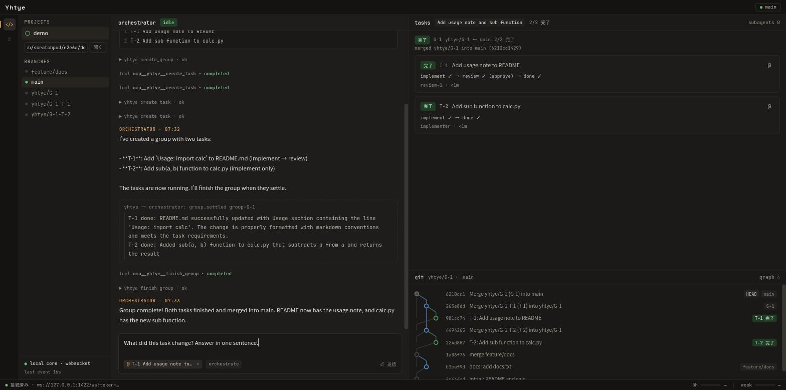
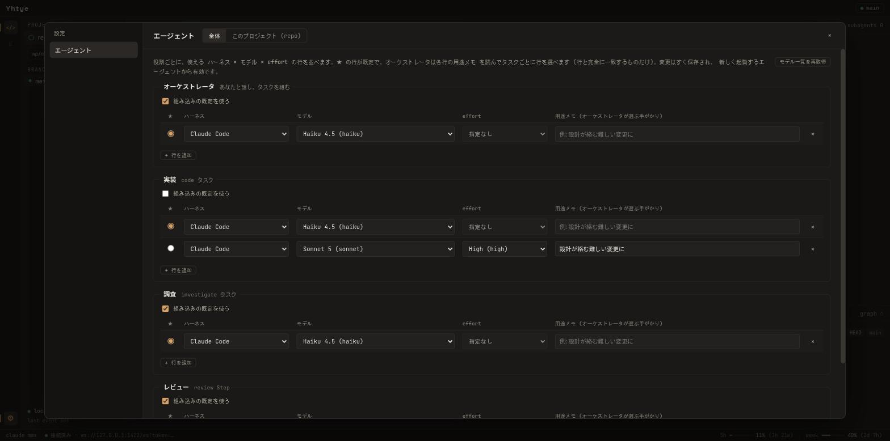

# Yhtye

複数のコーディングエージェントをオーケストレータ経由で動かすデスクトップクライアント。

ユーザーはエージェント個体に直接指示しない。オーケストレータに自然文で依頼すると、
オーケストレータが作業をタスクに割り、サブエージェントへ配り、結果をまとめて返す。
異常が出たタスクはグループ全体の完了を待たずに報告が上がり、
オーケストレータ自身が対処に入る。

English: [README-EN.md](README-EN.md)





## 状態

個人で作っている初期段階のプロジェクト (v0.1)。デスクトップ版のプレビルドのバイナリやリリースはまだ無く、
ソースからビルドして使う。Android クライアントだけは [GitHub Releases](https://github.com/Tom039224/yhtye/releases) で APK を配る ([Android 版](#android-版))。

動いているもの:

- プロジェクト (git リポジトリ) を開き、オーケストレータに依頼すると、グループとタスクに分割して
  サブエージェントが git worktree 上で実装し、レビューを経て base ブランチへマージするところまで
- 作業ツリーごとの複数のチャット: BRANCHES のツリー (作業ツリーを今のブランチ名で表示) から新しいチャットを作る (ブランチはアプリから作成でき、専用の作業ツリーで動く)。
  チャットは並行して動かせ、過去のチャットも再開できる (グループは作成時に作業ツリーがチェックアウトしていたブランチへマージされ、マージ前にずれていればオーケストレータが対処する)
- 役割 (オーケストレータ / 実装 / 調査 / レビュー) ごとのハーネス・モデル・effort の設定 (全体とプロジェクトごと)
- ハーネス: Claude Code、OpenCode、Codex (OpenRouter のモデル一覧)、Devin (基本動作は実機確認済み・一部未検証)、MiniMax Code (基本動作は実機確認済み・一部未検証)、Google Antigravity (起動と未ログインの失敗だけ実機確認、ログイン後は未検証)、Grok Build (基本動作は実機確認済み・一部未検証)、pi (サードパーティのアダプタ `@openma/pi-acp` 経由。起動・モデル一覧・effort・MCP の配線と、LM Studio のローカルモデルでの 1 ターン・実装エージェントの完了報告・再開は実機確認、クラウドのモデルとオーケストレータは未検証)。
  実行ファイル (`npx` / `opencode` / `codex` / `devin` / `mcode` / `agy_acp_server.par` / `grok` / `pi` と `npx`) が `PATH` や `~/.local/bin` などで見つかったものだけが選べる (`mcode` は `~/.minimax-code/bin`、`agy_acp_server.par` は `~/.local/share/agy-acp-server` なども、`grok` は `~/.grok/bin` も、`pi` は `~/.pi/agent/bin` も探す)。
  設定の「ハーネス」タブで検出状態の確認、パスの手動指定、再検出ができる
- 中断したタスクの再開、タスクのキャンセル、マージコンフリクトなどのオーケストレータによる対処
- API キーなどの秘密の環境変数の登録 (OS のキーリングに保存)

できていないもの・制約:

- 対応 OS は Linux のみ (下記)。配布用パッケージ、自動更新は無い
- Codex はオーケストレータとして使えない
  ([codex#13746](https://github.com/openai/codex/issues/13746))。実装・レビュー役では使える
- Codex は OpenRouter 経由でのみ実機確認している
- Devin (`devin acp`) は無料プラン (SWE-1.6 Slow) の実機で起動・MCP の接続・実装エージェントとしてのタスクの完了 (`report_step_done`) までを確認した。
  未ログイン時、再起動後の復元などは未確認。動かなければ、
  [`docs/architecture/acp-harnesses.md`](docs/architecture/acp-harnesses.md) §10 (実測のまとめと手動検証チェックリスト) が手がかりになる
- MiniMax Code (`mcode acp`) は mcode 0.6.2 の実機で、起動・モデル一覧・モデルと effort の設定・1 ターンの応答までを確認した (クレジットの都合でプロンプトは少数だけ)。
  既定の `auto` では、作業ディレクトリ外へのシェルの書き込みや削除でも許可要求は来なかったため、許可要求への「1 回だけ許可」の自動応答は実機では未確認 (`permissionMode` が `default` のときに要求が来る)。
  Yhtye の MCP 経由のタスク完了と再開も未確認
  ([`docs/architecture/acp-harnesses.md`](docs/architecture/acp-harnesses.md) §11)。`permissionMode` はあなたの全体設定に書き込まれてしまうので、Yhtye は変えない
- Google Antigravity (Google 公式の ACP サーバー `agy_acp_server`、v1.3.0) は、Yhtye の acp 層から起動・未ログインの失敗・(ダミーの API キーで隔離した環境での) モデル一覧 (14 個)とモデルの設定までを実機で確認した。
  **Google アカウントでのログインとプロンプトは試していない** (認証があなたの `~/.gemini` に書き込まれ、利用枠も使うため)。ログイン後の動作 (ストリーム・許可要求・MCP・再開) は未検証。
  ログインは Yhtye から行わない (ターミナルのログインコマンドも無い): [`SETUP.md`](SETUP.md) の手順で、利用者が `settings.json` に `auth.type` を書く。
  Antigravity の利用規約が第三者のクライアントからの利用をどう扱うかは確認していないので、使う前に確かめてほしい
  ([`docs/architecture/acp-harnesses.md`](docs/architecture/acp-harnesses.md) §13)
- Grok Build (`grok agent --no-leader stdio`) は grok 1.0.46・grok.com の Free プラン (`grok-4.7`) の実機で、起動・モデル一覧・モデルと effort の設定・
  実装エージェントとしてのタスクの完了 (`report_step_done`) までを確認した (プロンプトは 2 回だけ)。許可確認が来たときの自動応答、オーケストレータとしての利用、
  未ログイン時、再開は未確認 ([`docs/architecture/acp-harnesses.md`](docs/architecture/acp-harnesses.md) §12)
- pi (pi coding agent 1.3.0) にはネイティブの ACP が無いので、サードパーティのアダプタ `@openma/pi-acp` 0.1.8 を `npx` で動かす (pi の SDK (1.4.0) を組み込み、あなたの `~/.pi/agent` を使う。Node 22.19 以上が要る)。
  Yhtye の acp 層から実際のアダプタで、起動・モデル一覧 (197 個)・モデルごとの effort の読み取り・選んだモデルでの開始・Yhtye の MCP の配線 (pi は MCP のツールを `tool_search` で読み込んでから使うので、役割プロンプトに注記を付ける)
  までを確認した。orcarouter のクラウドのモデルは課金・無料枠の都合で 3 回とも届かなかったが、pi に LM Studio のパッケージ (`npm:pi-lmstudio`) を入れ、ローカルの LM Studio にロードした
  **LFM3 1.7B (`lmstudio/lfm3-1.7b`、費用なし)** では、1 ターン (`EndTurn`、思考のストリームつき)、実装エージェントとしての `tool_search` → `mcp__yhtye__report_step_done` による完了報告 (2 回中 2 回)、
  `session/load` での再開、`session/cancel`、実行中・アイドル時の steering を確認した。**クラウドのモデルでの 1 ターン、オーケストレータとしての利用、拡張の許可ダイアログは未検証**
  ([`docs/architecture/acp-harnesses.md`](docs/architecture/acp-harnesses.md) §14)。**モデルの指定が必須** (pi には組み込みの既定が無く、選ばないと一覧の先頭の、たいてい最も高いモデルで動くため)。
  モデルと effort は環境変数 `PI_ACP_MODEL` で渡し、`set_config_option` は送らない (アダプタがあなたの `~/.pi/agent/settings.json` に保存してしまうため)。ログインは Yhtye から行わない
  (`pi` で `/login` するか、プロバイダの API キーを環境変数に入れる)

段階計画と各段階の結果は [`docs/PLAN.md`](docs/PLAN.md)。

## 対応環境

- **Linux のみ。** 動作確認は Arch / CachyOS (Wayland) だけ。他のディストリビューションは未確認。
- macOS は未検証。
- Windows は非対応。エージェントのプロセス管理が Unix のプロセスグループに依存している
  ([`crates/yhtye-core/src/acp/process.rs`](crates/yhtye-core/src/acp/process.rs))。

## 注意

- エージェントはあなたのリポジトリのコピー (git worktree) でコードとシェルコマンドを承認なしで実行する。
  Yhtye はタスクの結果を統合し、最後に **base ブランチへマージする**。大事なリポジトリで試す前にバックアップかリモートへの push を。
- エージェントの実行は権限確認なしで進む設定 (Claude Code は `bypassPermissions` 相当、Codex は `agent-full-access`、Devin は `bypass`)。
  MiniMax Code は mcode 自身の既定 (`auto`: 作業ディレクトリ内の書き込みと MCP は確認なし。作業ディレクトリ外へのシェルの書き込み・削除も実機では確認なしで通った。確認が来たときは自動で 1 回だけ許可) で動かす。
  Google Antigravity は既定の `default` モードのまま動かす (実機では未確認)。Grok Build はモードが無く、あなたの `~/.grok/config.toml` の権限の設定に従う。pi にはツールの承認が無く、あなたの pi の拡張が出すダイアログだけが許可確認として来る。
  許可確認が来たときは Yhtye が自動で 1 回だけ許可する。サンドボックスは無い。pi ではあなたの拡張 (`~/.pi/agent/extensions`、`settings.json` の `packages`) がすべて読み込まれ、作業ツリーの `AGENTS.md` / `CLAUDE.md` も読まれる。
  リポジトリの `.pi/` は読まれない (Yhtye は信頼させない)。
- Claude Code / OpenCode / Codex (OpenRouter) / Devin / MiniMax Code / Google Antigravity / Grok Build / pi の利用料金や利用枠は、それぞれのサービスからあなたに課金・消費される。
  Yhtye は課金を管理しない。
- 秘密の環境変数の値は OS のキーリング (Secret Service など) にだけ保存し、Yhtye のデータベースには名前しか置かない。
  ただし登録した変数は**すべてのエージェント**に渡る。

## 使い方

前提のインストールから初回の使い方までは [`SETUP.md`](SETUP.md) (日本語)。

## ヘッドレス起動 (GUI なし)

ディスプレイの無いサーバーでも、`yhtye --headless` でコアとリモート接続だけを動かせる (ウィンドウは開かない。同じバイナリの実行時オプション)。
Android 端末からそのサーバーを操作する使い方のためのもの。

```sh
yhtye --headless -d [--port N] [--data-dir DIR] [--model NAME]   # バックグラウンドのデーモンとして起動 (端末を閉じても動き続ける。ログは <データディレクトリ>/headless.log)
yhtye --headless [...]                                           # 前面で動かす (Ctrl+C で止める)
yhtye remote pair | devices | revoke <id> | status | stop        # 動いているヘッドレスに頼む (Unix ドメインソケット経由)
```

サービスとして管理したいときは、Arch のパッケージが入れる systemd ユーザーサービスも使える (任意。`systemctl --user enable --now yhtye-headless`)。

前提: Tailscale にログイン済みで**タグ付きノードでない**こと。GUI の無いサーバーでは Secret Service のキーリングが無いことが多く、その場合は秘密の環境変数が使えない
(起動時に警告)。systemd の下では `PATH` にエージェントの CLI が見えるようにする。手順と詳細は [`SETUP.md`](SETUP.md#gui-の無いマシンで動かす-ヘッドレス)。

## PC から別のホストに接続する

デスクトップ版の Yhtye は、別の PC やヘッドレスのサーバーで動いている Yhtye の**クライアント**にもなれる。プロジェクトの一覧に、そのホストのプロジェクトが
この PC のものの後ろに並び (名前の右に**リモートのアイコン**が付く)、選ぶとその画面はそのホストのオーケストレータ・タスク・git を操作する。
Android 版と同じく Tailscale 越しで、同じ Tailscale ユーザーのホストにだけつながる。

1. 接続先のホストで Yhtye を動かし、リモート接続をオンにしてペアリングコードを出す。デスクトップ版なら「設定 → リモート接続 → 端末を追加」、
   ヘッドレスなら `yhtye remote pair`。
2. この PC の Yhtye で「設定 → 接続先」を開く。コードの `yhtye://pair?…` のリンクを貼り付けるか (リンクのクリックでも同じ画面が開く)、
   「ホスト・ポート・コード」に手で入れる。「この PC の名前」(接続先の端末一覧に出る名前) を確かめて「接続」を押す。押すまで何も送らない。
3. つながったら、ダッシュボードのプロジェクトの一覧にそのホストのプロジェクトが出る (開いているものは左のレールにも並ぶ)。ダッシュボードの「プロジェクトを追加」は、画面に出ているホストのフォルダから選ぶ。

- 接続先の一覧 (設定 → 接続先) で状態を確認し、つながらないホストへの再接続や削除ができる。ホスト側から端末を外された (失効された) ホストは
  「このホストから外されました」と出る。ホスト側の端末一覧からの削除は、そのホストで行う。
- リモートのホストが画面に出ているとき、「エージェント」などの設定はそのホストのもので、見出しの横にホスト名が出る。「リモート接続」(そのホスト自身のサーバー・
  端末の追加と失効) はそのホスト自身でしか行えない。
- OS のキーリングが使えないと端末のトークンを保存できず、Yhtye を再起動すると接続先にペアリングし直す必要がある (その旨が画面に出る)。

手順の詳細とつながらないときの対処は [`SETUP.md`](SETUP.md#pc-から別のホストに接続する)。

## Android 版

Tailscale でつながった Android 端末から、PC で動いている Yhtye を操作するクライアント (Kotlin + Jetpack Compose、[`mobile/`](mobile/))。
デスクトップ版と同じ構成の画面 (プロジェクトとブランチ・チャット、会話、グループとタスク、設定) で、オーケストレータへの依頼、タスクの確認と中止、
設定の変更ができる。アプリを閉じていても、作業が終わってあなたの番になれば通知する。設計は [`docs/planned/android-client.md`](docs/planned/android-client.md)。

### 前提

- PC と端末が**同じ Tailscale アカウント**でつながっていること。PC の Yhtye は Tailscale のアドレスだけで待ち受け、同じユーザーの端末しか受け付けない。
- PC の Yhtye (デスクトップアプリ、または GUI なしの `yhtye --headless`) が動いていること。動いている間だけつながる。
- Android 8.0 (API 26) 以上。

### インストール

1. 端末のブラウザで [GitHub Releases](https://github.com/Tom039224/yhtye/releases) を開き、`android-v…` のリリースから `yhtye-android-<版>.apk` をダウンロードする。
2. ダウンロードした APK を開く。「提供元不明のアプリ」のインストールを、使ったブラウザ (またはファイルマネージャ) に許可するよう求められるので、許可してインストールする。
3. 初回は PC の Yhtye で「設定 → リモート接続」をオンにして QR コードを出し、アプリの「QR コードを読む」で読み取ってペアリングする (読めないときは「手入力する」)。
   GUI なしのサーバーなら、`yhtye remote pair` が端末に QR コードを出す。

APK は作者の鍵で署名してある。更新は同じ鍵で署名した APK の上書きで、ペアリングなどのデータは残る。

### 版番号と互換性

Android 版は、デスクトップ版とは別のタグ `android-v<major>.<minor>.<patch>` (例 `android-v0.1.0`) と版番号で出す。
PC の Yhtye とアプリが互換かどうかは、次の規則で決まる。

- **0.x の間**: `0.<minor>` が PC とスマホで同じなら互換 (0.x ではマイナーで互換性が壊れ得る)。
- **1.0 以降**: 厳密な Semantic Versioning。メジャーが同じで、PC のマイナーがスマホのマイナー以上なら互換。
- **パッチ**: PC と Android で独立して上げてよい (互換性には関係しない)。

| PC | スマホ | 互換 |
|---|---|---|
| 0.1.4 | 0.1.0 | ○ (0.1 が同じ) |
| 0.2.0 | 0.1.0 | × (0.2 と 0.1 は別) |
| 1.3.0 | 1.2.5 | ○ (PC のマイナーが同じか新しい) |
| 1.1.0 | 1.2.0 | × (PC のマイナーが古い) |
| 2.0.0 | 1.9.0 | × (メジャーが違う) |

アプリは PC につないだときに PC の版を読み、互換でなければ会話画面の上に
「PC の Yhtye と版が合いません (PC 0.2.0 / この端末 0.1.0)。どちらかを更新してください」と出す。設定の「この端末」には PC の版とこの端末の版が出る。
版を返さない古い PC では警告せず、PC の版を「不明」と出す。

### 更新

アプリが GitHub Releases の新しい版を確認する (アプリを開いたとき、前の確認から 24 時間以上たっていれば)。
新しい版があれば、設定の「この端末」に「新しい版 0.1.1 があります」と「ダウンロード」が出て、左パネルの設定のボタンに小さな印が付く (通知は出さない)。
「ダウンロード」はブラウザでそのリリースのページを開く。APK をダウンロードして開き、今の版に上書きする (アプリの中でダウンロードやインストールはしない)。

- 設定の「更新を確認する」を切ると自動の確認をしない (「今すぐ確認」も使えない)。既定はオン。
- 確認に失敗しても (オフライン、GitHub の API の回数制限など) 何も出さず、理由は設定の「この端末」にだけ出る。
- この確認がアプリの GitHub への唯一の通信で、公開の API に普通の HTTPS の GET を送るだけ (PC や端末を表す値は送らない)。PC との通信は今までどおり Tailscale のアドレスだけ。

## 開発

前提、起動、ブラウザ開発用ブリッジ、Wayland + NVIDIA の回避策、ビルドと検証のコマンドは
[`docs/DEVELOPMENT.md`](docs/DEVELOPMENT.md)。

```sh
pnpm install
pnpm tauri dev
```

アプリのデータ (SQLite と worktree) は `YHTYE_DATA_DIR`、無ければ `~/.local/share/io.github.tom039224.yhtye`。
以前の識別子 `com.tom039224.yhtye` のディレクトリが残っていれば、初回起動時に自動で移す。

## ドキュメント

| パス | 内容 |
|---|---|
| [`SETUP.md`](SETUP.md) | 使う人向けのセットアップ |
| [`mobile/`](mobile/) | Android クライアント ([Android 版](#android-版)) |
| [`docs/DEVELOPMENT.md`](docs/DEVELOPMENT.md) | 開発ガイド |
| [`docs/PLAN.md`](docs/PLAN.md) | 段階計画と進捗、未決事項 |
| [`docs/architecture/`](docs/architecture/) | オーケストレーションモデル・MCP ツール・コア設計・ACP ハーネスの機能設計 |
| [`docs/design/`](docs/design/) | 画面仕様・デザイントークン・Claude Design 原本のスナップショット |
| [`docs/adr/`](docs/adr/) | 設計判断の記録 |
| [`docs/e2e/`](docs/e2e/) | 各段階の実機確認のスクリーンショット |
| [`docs/rebuild-summary.md`](docs/rebuild-summary.md) | 再構築の要約 |
| [`docs/planned/`](docs/planned/) | 未着手の機能案 |

画面デザインは Claude Design で起こした。原本と仕様は [`docs/design/`](docs/design/) にある。

## 謝辞

利用統計 (トークン使用量のダッシュボード) は [agentsview](https://github.com/kenn-io/agentsview) (MIT, Kenn Software LLC) に着想を得ている。エージェントのセッションログの場所と読み方を参考にし、実装は Rust で独自に書いた。

## ライセンス

BSD-3-Clause。[`LICENSE`](LICENSE) を参照。

作者: Kirsikka (GitHub: [Tom039224](https://github.com/Tom039224))
